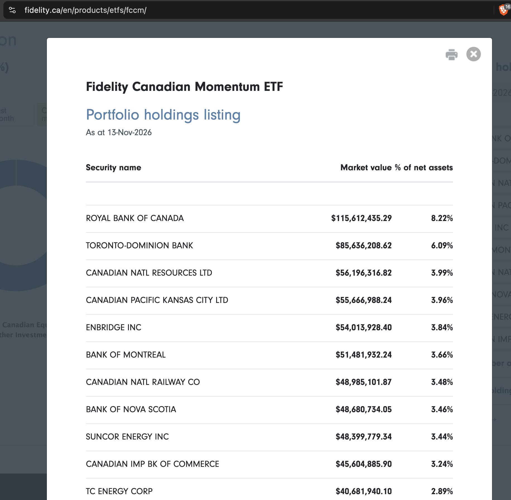

## The problem

```{=html}
<div class="prob">
  
  <div class="prob-text">
    <p class="lead">Investly and Fidelity help people invest in ETFs. <strong>But once the money is in, most clients stop paying attention.</strong></p>
    <p class="dt-h">What an FCCM investor sees today</p>
    <ul class="dt-list">
      <li class="yes">Company names and weights</li>
      <li class="no">How each company is performing</li>
      <li class="no">Returns by quarter or by year</li>
    </ul>
    <ul class="prob-facts">
      <li>Investors who get clear explanations of <strong>why</strong> their investments performed are more satisfied and more loyal.<sup>1</sup></li>
      <li>Trading more isn't the fix: ETF investors earned <strong>1.6% a year less</strong> than their own ETFs by buying and selling at the wrong time.<sup>2</sup></li>
    </ul>
  </div>
</div>
<p class="src">1 J.D. Power, Canadian Full Service Investor Satisfaction Study · 2 Morningstar, "Mind the Gap" (10 years to Dec. 31, 2025)</p>
```

## Goal and scope

```{=html}
<p class="lead"><strong>Goal: keep ETF investors involved every month, without asking them to trade.</strong></p>
<p>Each month the investor gets a report on <em>their own</em> ETF: which companies moved it, and by how much. They follow their money; they don't have to touch it.</p>
<table>
<thead><tr><th>Feature</th><th>What the investor sees</th><th>Status</th></tr></thead>
<tbody>
<tr><td><strong>Performance by quarter and year</strong></td><td>Each company's return next to its weight, and its contribution to the fund</td><td><span class="tag done">LIVE</span></td></tr>
<tr><td><strong>News and sentiment</strong></td><td>Last month's key news per company, rated <em>Very good / Good / Bad / Very bad</em>, with a source link</td><td><span class="tag next">NEXT</span></td></tr>
</tbody>
</table>
<p class="src">Funds: FCCL, FCCV, FCCQ, FCCM (the four ETFs inside FCCA) · Updated monthly · Live web dashboard</p>
```

## The solution in one picture

```{=html}
<style>
#pflow { margin-top: 4px; }
#pflow .pf-svg { width: 100%; height: auto; display: block; font-family: inherit; }
#pflow .pf-group { fill: rgba(255,255,255,.03); stroke: #8a94a6; stroke-width: 2; stroke-dasharray: 6 5; }
#pflow .pf-grouplabel { fill: #c3cad6; font-size: 17px; font-weight: 600; }
#pflow #pf-lines line { stroke: #6b7689; stroke-width: 3; transition: stroke .3s; }
#pflow #pf-lines line.on { stroke: #ffd166; stroke-width: 5; }
#pflow .pf-tipfill { fill: #ffd166; }
#pflow .pf-node rect { fill: #262f3d; stroke: #6b7689; stroke-width: 2; transition: all .3s; }
#pflow .pf-node text { text-anchor: middle; }
#pflow .pf-node .t { fill: #ffffff; font-size: 24px; font-weight: 800; }
#pflow .pf-node .s { fill: #c3cad6; font-size: 16px; }
#pflow .pf-node.on rect { fill: #34405a; stroke: #ffd166; stroke-width: 4; filter: drop-shadow(0 0 12px rgba(255,209,102,.45)); }
#pflow #pf-dotbg { fill: #ffd166; }
#pflow #pf-dottext { fill: #1b1b1b; font-size: 14px; font-weight: 800; text-anchor: middle; }
#pflow .pf-bar { display: flex; justify-content: space-between; align-items: center; gap: 18px; margin-top: 12px; font-size: 0.7em; }
#pflow .pf-cap { flex: 1; min-height: 2.6em; line-height: 1.35; color: #fff; }
#pflow .pf-when { display: inline-block; background: #ffd166; color: #1b1b1b; font-weight: 800; border-radius: 99px; padding: 1px 10px; margin-right: 10px; font-size: .9em; }
#pflow .pf-ctl { display: flex; gap: 5px; align-items: center; white-space: nowrap; }
#pflow .pf-ctl button { width: 30px; height: 30px; border-radius: 99px; border: 1px solid #6b7689; background: #262f3d; color: #c3cad6; font-weight: 700; font-size: 14px; line-height: 1; cursor: pointer; padding: 0; }
#pflow .pf-ctl button.on { background: #ffd166; color: #1b1b1b; border-color: #ffd166; }
#pflow #pf-play { margin-left: 8px; width: 38px; }
</style>
<div class="pflow" id="pflow">
<svg viewBox="0 0 1160 470" class="pf-svg" role="img" aria-label="Animated data flow: Fidelity and Alpha Vantage feed n8n workflows, which store everything in Postgres; the dashboard reads Postgres">
  <defs><marker id="pf-tip" viewBox="0 0 10 10" refX="9" refY="5" markerUnits="userSpaceOnUse" markerWidth="14" markerHeight="14" orient="auto-start-reverse"><path d="M0,0 L10,5 L0,10 z" class="pf-tipfill"/></marker></defs>
  <rect class="pf-group" x="30" y="168" width="800" height="136" rx="18"/>
  <text class="pf-grouplabel" x="816" y="188" text-anchor="end">n8n · runs every step</text>
  <g id="pf-lines">
    <line data-l="0" x1="150" y1="100" x2="150" y2="196"/>
    <line data-l="1" x1="150" y1="276" x2="150" y2="380"/>
    <line data-l="2" x1="430" y1="100" x2="430" y2="196"/>
    <line data-l="3" x1="430" y1="276" x2="430" y2="380"/>
    <line data-l="4" x1="710" y1="276" x2="710" y2="380"/>
    <line data-l="5" x1="830" y1="425" x2="900" y2="425"/>
  </g>
  <g class="pf-node fid" data-n="fid"><rect x="60" y="30" width="180" height="70" rx="12"/><text x="150" y="62" class="t">Fidelity</text><text x="150" y="84" class="s">ETF holdings &amp; weights</text></g>
  <g class="pf-node src" data-n="av"><rect x="340" y="30" width="180" height="70" rx="12"/><text x="430" y="62" class="t">Alpha Vantage</text><text x="430" y="84" class="s">Month-end prices</text></g>
  <g class="pf-node n8n" data-n="hold"><rect x="50" y="196" width="200" height="80" rx="12"/><text x="150" y="228" class="t">Holdings</text><text x="150" y="250" class="s">refresh + AI agent</text></g>
  <g class="pf-node n8n" data-n="price"><rect x="330" y="196" width="200" height="80" rx="12"/><text x="430" y="228" class="t">Prices</text><text x="430" y="250" class="s">monthly collection</text></g>
  <g class="pf-node n8n" data-n="ret"><rect x="610" y="196" width="200" height="80" rx="12"/><text x="710" y="228" class="t">Returns</text><text x="710" y="250" class="s">AI agent (Gemini)</text></g>
  <g class="pf-node db" data-n="pg"><rect x="30" y="380" width="800" height="90" rx="14"/><text x="430" y="418" class="t">Postgres database</text><text x="430" y="444" class="s">holdings · tickers · prices · returns (computed in SQL) · summaries</text></g>
  <g class="pf-node web" data-n="web"><rect x="900" y="380" width="230" height="90" rx="14"/><text x="1015" y="418" class="t">Live dashboard</text><text x="1015" y="444" class="s">reads on every visit</text></g>
  <g id="pf-dot" style="opacity:0"><rect id="pf-dotbg" x="-48" y="-14" width="96" height="28" rx="14"/><text id="pf-dottext" x="0" y="5"></text></g>
</svg>
<div class="pf-bar">
  <div class="pf-cap"><span class="pf-when" id="pf-when"></span><span id="pf-text"></span></div>
  <div class="pf-ctl"><span id="pf-steps"></span><button id="pf-play" title="Pause / play">❚❚</button></div>
</div>
</div>
<script>
(function () {
  const root = document.getElementById('pflow'); if (!root || root.dataset.ready) return; root.dataset.ready = 1;
  const S = [
    { l: 0, rev: false, from: 'fid', to: 'hold', pkt: 'holdings', when: 'Day 1', txt: 'n8n downloads the full holdings list of each ETF from Fidelity.' },
    { l: 1, rev: false, from: 'hold', to: 'pg', pkt: 'tickers', when: 'Day 1', txt: 'The AI agent matches each company to its stock ticker; everything is saved in Postgres.' },
    { l: 3, rev: true, from: 'pg', to: 'price', pkt: 'to-do list', when: 'Days 2–7', txt: 'n8n asks Postgres which companies still need a price (about 24 a day).' },
    { l: 2, rev: false, from: 'av', to: 'price', pkt: 'prices', when: 'Days 2–7', txt: 'n8n fetches month-end prices from Alpha Vantage.' },
    { l: 3, rev: false, from: 'price', to: 'pg', pkt: 'prices', when: 'Days 2–7', txt: 'Prices are saved, and Postgres calculates quarterly, annual and YTD returns.' },
    { l: 4, rev: true, from: 'pg', to: 'ret', pkt: 'returns', when: 'Monthly', txt: 'The Returns agent reads which holdings drove the fund up or down…' },
    { l: 4, rev: false, from: 'ret', to: 'pg', pkt: 'summary', when: 'Monthly', txt: '…and saves a plain-language summary.' },
    { l: 5, rev: false, from: 'pg', to: 'web', pkt: 'report', when: 'Any time', txt: 'The dashboard reads the latest numbers from Postgres every time it is opened.' }
  ];
  const q = s => root.querySelector(s), qa = s => [...root.querySelectorAll(s)];
  const dot = q('#pf-dot'), steps = q('#pf-steps');
  steps.innerHTML = S.map((_, i) => `<button data-i="${i}">${i + 1}</button>`).join('');
  let i = 0, playing = true, timer = null, raf = null;
  function show(k) {
    i = (k + S.length) % S.length; const s = S[i];
    qa('#pf-lines line').forEach(l => { l.classList.remove('on'); l.removeAttribute('marker-end'); l.removeAttribute('marker-start'); });
    qa('.pf-node').forEach(n => n.classList.toggle('on', n.dataset.n === s.from || n.dataset.n === s.to));
    qa('#pf-steps button').forEach((b, j) => b.classList.toggle('on', j === i));
    const line = q(`#pf-lines line[data-l="${s.l}"]`); line.classList.add('on');
    line.setAttribute(s.rev ? 'marker-start' : 'marker-end', 'url(#pf-tip)');
    let x1 = +line.getAttribute('x1'), y1 = +line.getAttribute('y1'), x2 = +line.getAttribute('x2'), y2 = +line.getAttribute('y2');
    if (s.rev) [x1, y1, x2, y2] = [x2, y2, x1, y1];
    q('#pf-dottext').textContent = s.pkt; q('#pf-when').textContent = s.when; q('#pf-text').textContent = `${i + 1}. ${s.txt}`;
    const w = Math.max(70, s.pkt.length * 9 + 26); q('#pf-dotbg').setAttribute('x', -w / 2); q('#pf-dotbg').setAttribute('width', w);
    cancelAnimationFrame(raf); const t0 = performance.now(), D = 800;
    const step = t => { const p = Math.min(1, (t - t0) / D), e = p < .5 ? 2 * p * p : 1 - Math.pow(-2 * p + 2, 2) / 2;
      dot.setAttribute('transform', `translate(${x1 + (x2 - x1) * e},${y1 + (y2 - y1) * e})`); dot.style.opacity = p > .97 ? 1 - (p - .97) * 20 : 1;
      if (p < 1) raf = requestAnimationFrame(step); };
    raf = requestAnimationFrame(step);
  }
  function loop() { clearInterval(timer); if (playing) timer = setInterval(() => show(i + 1), 2000); }
  steps.onclick = e => { const b = e.target.closest('button'); if (b) { show(+b.dataset.i); loop(); } };
  q('#pf-play').onclick = () => { playing = !playing; q('#pf-play').textContent = playing ? '❚❚' : '▶'; loop(); };
  show(0); loop();
})();
</script>
```

## Built on Fidelity × n8n

```{=html}
<div class="sponsors">
  <div class="sp fid"><div class="name">Fidelity</div><div class="role">The data and the question</div><ul><li>The four ETFs inside <b>FCCA</b>: FCCL, FCCV, FCCQ, FCCM</li><li><b>Full holdings list</b> from Fidelity's product data: 269 holdings, weights summing to ~100%</li><li>Refreshed on day 1 of every month, so the report always matches the fund</li><li>The report answers the question Fidelity's page leaves open: <i>how is each holding doing?</i></li></ul></div>
  <div class="sp n8n"><div class="name">n8n</div><div class="role">The engine that runs everything</div><ul><li><b>4 workflows</b>: 2 scheduled, 2 AI agents</li><li><b>AI Agent node</b> with tools: Postgres queries and a Fidelity fetch sub-workflow</li><li><b>Schedule Trigger</b> runs the monthly cycle with no manual steps</li><li><b>HTTP Request</b> batching keeps within the free price API limit (25 a day)</li></ul></div>
</div>
```

## Demo {.center}

```{=html}
<div class="demo-link">
  <p class="dl-k">Live demo</p>
  <p class="dl-url"><a href="https://chimerical-arithmetic-142fdb.netlify.app" target="_blank">chimerical-arithmetic-142fdb.netlify.app</a></p>
</div>
```

## Innovation and impact

```{=html}
<div class="impact">
  <div class="ic"><b>For the investor</b>
    <ul>
      <li>Understands <strong>who drives their fund</strong>: weight × return = each holding's contribution.</li>
      <li>A <strong>monthly reason to come back</strong>, with no trades needed and no money at risk.</li>
      <li>Honest data: missing values show as <em>n/a</em>, never guessed.</li>
    </ul>
  </div>
  <div class="ic"><b>For Fidelity and Investly</b>
    <ul>
      <li><strong>Engaged investors invest more and stay:</strong> 74% of Finimize's customers say they would invest more with more chances to learn.<sup>1</sup></li>
      <li><strong>Retention is revenue:</strong> for one asset manager, 21% higher retention meant 33% higher revenue.<sup>2</sup></li>
      <li><strong>Regular touchpoints</strong> improve understanding and investment discipline.<sup>3</sup></li>
      <li><strong>Low cost:</strong> fully automated in n8n, using data Fidelity already has.</li>
    </ul>
  </div>
</div>
<p class="src">1 Finimize, "Customer Engagement for Financial Services", 2024 · 2 SS&amp;C, "Digital Engagement Drives Retention" · 3 FNZ, platform engagement data</p>
```

## Thank you {.center}

**ETF Agent Report**

Linh Dan Ngo · Evan Lin · Dylan Li · Luis Mario

Live dashboard: <https://chimerical-arithmetic-142fdb.netlify.app>

Code: <https://github.com/itsluismario/ETF-agent-report>

```{=html}
<div class="powered">Built with Fidelity data · orchestrated by n8n</div>
```

<small class="muted">Information only, not investment advice. Data: Fidelity Canada product data, Alpha Vantage.</small>
