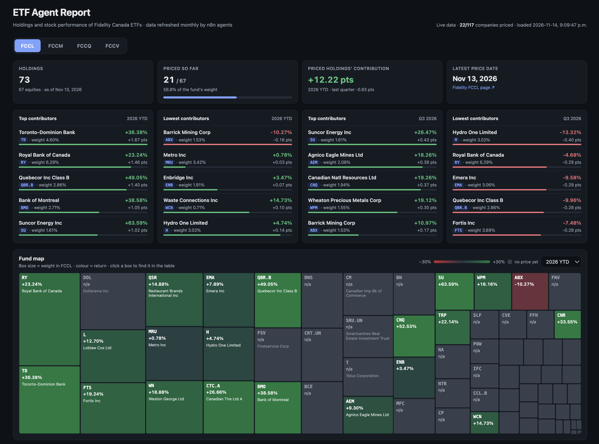
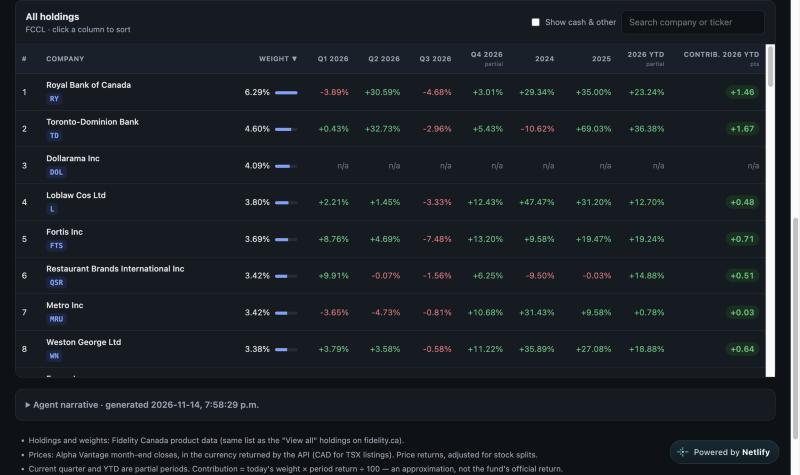

## The problem {.smaller}

::: {.lead}
Fidelity's ETF pages for **FCCA** and its four underlying ETFs (**FCCL, FCCV, FCCQ, FCCM**) list each fund's holdings and the percentage weight of each company.

**That's all they show.**
:::

- They don't say **how each company has performed**, or **what has been happening** with it.
- An investor can see *what they own and how much*, but not *how each holding is doing*.
- To find out, they have to look up each company by hand: **more than 100 companies** across the four ETFs (117 with a stock ticker).

::: notes
Open with the fund page: a list of names and weights, nothing else. Then the pain: 117 companies to research by hand, every month.
:::

## Why it matters

::: {.columns}
::: {.column width="48%"}
<p class="muted">The fund page answers</p>
<p class="big">"What's in<br>my ETF?"</p>
:::
::: {.column width="52%"}
<p class="muted">The investor actually needs</p>
<p class="big accent">"Which companies are helping or hurting my returns, and why?"</p>
:::
:::

<br>

This report fills that gap: it pairs each holding's **weight** with its **performance** and its **news**, so the investor can understand and monitor the fund **month by month**.

## Goal and scope

Build a **monthly report** that shows, for every company in the ETF, its historical performance and its recent news.

| | Feature | Status |
|---|---|---|
| 2 | **Performance by quarter and by year**: % return for each quarter (Q1–Q4) and year, next to the company's weight, with each holding's contribution to the fund | <span class="tag done">LIVE</span> |
| 1 | **News and sentiment per company**: last month's most relevant news, rated *Very good / Good / Bad / Very bad*, with a short summary and source link | <span class="tag next">NEXT</span> |

<small>Funds: FCCL, FCCV, FCCQ, FCCM (the four ETFs inside FCCA) · Frequency: monthly · Per company: ETF weight, quarterly and annual returns, contribution · Delivery: live web dashboard</small>

## The solution in one picture

```{=html}
<div class="hub">
  <div class="col-h">Data source</div><div></div><div class="col-h"><span class="chip n8n">n8n</span> orchestration</div><div></div><div class="col-h">Storage</div><div></div><div class="col-h">Website</div>

  <div class="node src fid"><span class="chip fid">Sponsor</span><b>Fidelity</b>Full holdings &amp; weights of FCCL, FCCV, FCCQ, FCCM</div><div class="arrow">→</div>
  <div class="node wf n8n"><b>Holdings refresh + Holdings Agent</b>Day 1 · finds TSX tickers</div><div class="arrow both">⇄</div>
  <div class="node db"><b>Supabase (Postgres)</b>Shared database<ul><li><code>etf_constituents</code> holdings + tickers</li><li><code>price_monthly</code> prices</li><li><code>perf_returns</code> returns, computed in SQL</li><li><code>report_runs</code> agent summaries</li></ul><span class="sm">Every n8n workflow reads its work from here and writes its results back</span></div>
  <div class="arrow out">→</div>
  <div class="node web"><b>Netlify dashboard</b>Calls <code>get_public_report()</code> on every visit (read-only key)</div>

  <div class="node src"><b>Alpha Vantage</b>Month-end prices</div><div class="arrow">→</div>
  <div class="node wf n8n"><b>Price collection</b>Days 2–7 · ~24 tickers a day</div><div class="arrow both">⇄</div>

  <div class="node src"><b>Gemini</b>Model inside the n8n AI Agents</div><div class="arrow">→</div>
  <div class="node wf n8n"><b>Returns Agent</b>Writes the summary</div><div class="arrow both">⇄</div>
</div>
```

<br>

<small class="muted">n8n runs every step; ⇄ = the workflow reads from and writes to the database. No manual steps.</small>

## Built on our sponsors: Fidelity × n8n

```{=html}
<div class="sponsors">
  <div class="sp fid"><span class="chip fid">Sponsor</span><div class="name">Fidelity</div><div class="role">The data and the question</div><ul><li>The four ETFs inside <b>FCCA</b>: FCCL, FCCV, FCCQ, FCCM</li><li><b>Full holdings list</b> from Fidelity's product data: 269 holdings, weights summing to ~100%</li><li>Refreshed on day 1 of every month, so the report always matches the fund</li><li>The report answers the question Fidelity's page leaves open: <i>how is each holding doing?</i></li></ul></div>
  <div class="sp n8n"><span class="chip n8n">Sponsor</span><div class="name">n8n</div><div class="role">The engine that runs everything</div><ul><li><b>4 workflows</b>: 2 scheduled, 2 AI agents</li><li><b>AI Agent node</b> with tools: Postgres queries and a Fidelity fetch sub-workflow</li><li><b>Schedule Trigger</b> runs the monthly cycle with no manual steps</li><li><b>HTTP Request</b> batching keeps within the free price API limit (25 a day)</li></ul></div>
</div>
```

## How it runs every month

```{=html}
<div class="timeline">
  <div class="step"><div class="d">Day 1</div><b>Holdings refresh</b><br>Downloads the latest holdings of FCCL, FCCV, FCCQ and FCCM from Fidelity (269 holdings) and reuses the tickers it already knows.</div>
  <div class="step"><div class="d">Days 2–7</div><b>Price collection</b><br>Gets month-end prices for ~24 companies a day (the free API allows 25 a day). Six days cover all 117 companies.</div>
  <div class="step"><div class="d">Any time</div><b>Report and dashboard</b><br>The Returns Agent writes the summary; the dashboard reads live data from Supabase on every visit.</div>
</div>
```

<br>

| Workflow | Type | Role |
|---|---|---|
| Holdings – monthly refresh | Scheduled (day 1) | Full holdings list per ETF |
| ETF Holdings Agent | AI agent (Gemini Flash-Lite) | Maps company names to TSX tickers |
| Prices – monthly Alpha Vantage fetch | Scheduled (days 2–7) | Prices → returns in SQL |
| ETF Returns Agent | AI agent (Gemini Flash-Lite) | Top / lowest contributors summary |

## Technical depth: what made it hard

| Challenge | How we solved it |
|---|---|
| Fidelity's page shows only the **top 10** holdings | Used Fidelity's own product data behind the "View all" button: the **full list**, weights summing to ~100% |
| Fidelity gives **names, not tickers** | The Holdings Agent assigns TSX tickers once; they are **cached** and reused every month |
| **Yahoo Finance blocks** cloud servers (HTTP 429) | Switched to **Alpha Vantage** (free key) with a **queue**: 24 companies a day, failed symbols move to the back |
| **Stock splits** looked like crashes (Loblaw −67%) | Split detection in SQL from adjusted vs. raw prices → real return **+31.20%** |
| Free AI model allows **20 requests a day** | Moved to **Gemini Flash-Lite** (~500/day) and redesigned the agents to use **2 requests per run** |
| A public page must not expose the database | Row Level Security on every table; the public key can call **one read-only function** only |

::: notes
Each row is a real problem we hit while building, not a hypothetical one.
:::

## It actually works

```{=html}
<div class="stats">
  <div class="stat"><div class="n">4</div><div class="l">ETFs covered</div></div>
  <div class="stat"><div class="n">269</div><div class="l">holdings with weights</div></div>
  <div class="stat"><div class="n">117</div><div class="l">companies with a ticker</div></div>
  <div class="stat"><div class="n">$0</div><div class="l">running cost (free tiers)</div></div>
</div>
```

<br>

- Holdings match Fidelity's full list: weights sum to **99.99–100.02%** per ETF.
- Real prices verified, e.g. Royal Bank closed at **288.37 CAD** on Nov 13, 2026.
- Example insight (FCCL, 2026 YTD): **Toronto-Dominion Bank** returned <span class="pos">+36.38%</span> with a 4.60% weight, contributing <span class="pos">+1.67 pts</span>, the top contributor.
- Tested end to end: holdings → prices → returns → summary → live page.

## Design and user experience

{.shot width="92%"}

<small>Tabs per ETF · how much of the fund is priced so far · top and lowest contributors for the year and the last quarter, with bars sized by contribution</small>

## Every holding, side by side

{.shot width="92%"}

<small>Weight next to quarterly and annual returns · contribution pills · sortable columns · search by company or ticker · partial periods labelled</small>

## Demo: problem → solution → working product

1. **The problem**: open a Fidelity ETF page. It shows names and weights, nothing about performance.
2. **The solution**: show the n8n workflows and the monthly cycle (holdings on day 1, prices on days 2–7).
3. **The agent**: ask the Holdings Agent for *"FCCM"*: it builds the full list and finds the tickers.
4. **The product**: open the live dashboard, switch ETFs, sort by contribution and search for a company.
5. **The insight**: "Toronto-Dominion Bank added +1.67 points to FCCL this year."

<small class="muted">Live dashboard: <https://chimerical-arithmetic-142fdb.netlify.app></small>

## Innovation and impact

- **Original pairing**: weight × return = each holding's contribution, so the investor sees **who drives the fund**, not just who is in it.
- **Real time saved**: from researching 117 companies by hand every month to a report that builds itself.
- **Built to be trusted**: missing data is shown as *n/a*, never guessed; AI-assigned tickers are marked *unverified* until a price confirms them.
- **Accessible**: runs entirely on free tiers (n8n, Supabase, Alpha Vantage, Gemini Flash-Lite, Netlify).

## Limitations, honestly

- **Feature 1 (news and sentiment) is not built yet.** It is the next step.
- **FCCA itself** is not shown yet: we cover its four underlying ETFs; the combined FCCA view is planned.
- **Prices fill in over the month**: the free API allows 25 calls a day, so a full refresh takes 6 days. Today 22 of 117 companies are priced; the rest arrive on days 2–7.
- A few symbols are **not available** from the price source (e.g. Dollarama, Canadian Pacific) and show *n/a*.
- Contribution uses **today's weights** for past periods: an approximation, not the fund's official return.

## Next steps

| | |
|---|---|
| <span class="tag next">FEATURE 1</span> **News and sentiment** | A News Agent collects each company's most relevant news from the past month, rates each item and the month as *Very good / Good / Bad / Very bad*, and stores a short summary with the source link |
| <span class="tag next">FCCA</span> **Combined view** | Combine FCCA's weight in each ETF with each company's weight in that ETF |
| <span class="tag next">DELIVERY</span> **Monthly email or PDF** | Send the summary and a link to the dashboard on the 8th of each month |
| <span class="tag next">COVERAGE</span> **Faster price refresh** | A paid data tier, or a second source for symbols that are missing |

## How we meet the judging criteria

```{=html}
<div class="criteria">
  <div class="c"><b>Technical Depth &amp; Execution</b><br>4 workflows, 2 AI agents, SQL return engine with split adjustment, rate-limit queue, secured public API. Working end to end.</div>
  <div class="c"><b>Innovation &amp; Impact</b><br>Turns "what's in my ETF" into "who drives my returns". Replaces hours of manual research every month, at $0.</div>
  <div class="c"><b>Design &amp; User Experience</b><br>One page per ETF: summary cards, contributor rankings, a sortable and searchable table, plain-language notes.</div>
  <div class="c"><b>Demo</b><br>Problem (Fidelity page) → solution (agents and monthly cycle) → working product (live dashboard).</div>
</div>
```

## Thank you {.center}

**ETF Agent Report**

Live dashboard: <https://chimerical-arithmetic-142fdb.netlify.app>

Code: <https://github.com/itsluismario/ETF-agent-report>

```{=html}
<div class="powered"><span>Built with</span><span class="chip fid big">Fidelity</span><span>data · orchestrated by</span><span class="chip n8n big">n8n</span></div>
```

<small class="muted">Information only, not investment advice. Data: Fidelity Canada product data, Alpha Vantage.</small>
